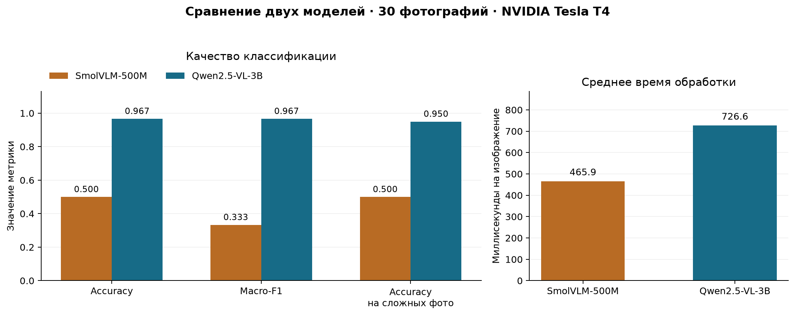

# Практическая работа № 3
## Классификация самолётов по фотографии с помощью мультимодальных языковых моделей

**Группа № 4**

- Гусев Алексей Дмитриевич
- Дворников Петр Михайлович
- Еникеев Дамир Илмирович
- Майоров Егор Александрович

## Цель работы

Сравнить SmolVLM-500M-Instruct и Qwen2.5-VL-3B-Instruct в задаче определения военного или гражданского назначения самолёта по фотографии.

## Эксперимент

Выборка включает **30 фотографий**: 15 военных и 15 гражданских самолётов. Из них 20 представляют нетривиальные случаи: военные транспортные и учебные самолёты, заправщики на базе авиалайнеров, гражданские грузовые и спортивные самолёты.

Модели загружены из Hugging Face Hub и выполнены в Google Colab на **NVIDIA Tesla T4**. Для каждой фотографии использованы одинаковая инструкция и генерация без случайного выбора. Получено **60 предсказаний**.

## Результаты

| Модель | Верно | Accuracy | Precision macro | Recall macro | Macro-F1 |
|---|---:|---:|---:|---:|---:|
| Qwen2.5-VL-3B | 29/30 | 96,67% | 0,969 | 0,967 | 0,967 |
| SmolVLM-500M | 15/30 | 50,00% | 0,250 | 0,500 | 0,333 |

**Qwen2.5-VL-3B правильно классифицировала 29 из 30 фотографий**, включая 19 из 20 сложных случаев. Единственная ошибка — Lockheed L-100 Hercules. SmolVLM-500M во всех случаях выбрала класс «военный», получив 50% accuracy на сбалансированной выборке.

## Отчёт

[Полный отчёт с таблицами, графиками и разбором ошибок](report.ipynb)

Таблицы и изображения сохранены в отчёте и доступны без выполнения кода.

## Воспроизведение

Открыть отчёт в Google Colab и выполнить ячейки раздела «Воспроизведение эксперимента». По умолчанию анализируются сохранённые результаты. Для повторного запуска моделей установить `RUN_EXPERIMENT = True` и выбрать GPU в настройках среды. Новый прогон сохраняется отдельно от опубликованных результатов.

## Структура репозитория

| Путь | Содержимое |
|---|---|
| `report.ipynb` | Отчёт о выполненной работе |
| `src/experiment.py` | Классификация и расчёт метрик |
| `src/visualization.py` | Построение сравнительных графиков |
| `config.json` | Версии моделей и параметры эксперимента |
| `data/` | Фотографии, разметка, источники и лицензии |
| `results/` | Исходные ответы, метрики, матрицы ошибок и графики |
| `tests/` | Проверки обработки ответов и расчёта метрик |

## Источники и лицензии

Модели: [SmolVLM-500M-Instruct](https://huggingface.co/HuggingFaceTB/SmolVLM-500M-Instruct), [Qwen2.5-VL-3B-Instruct](https://huggingface.co/Qwen/Qwen2.5-VL-3B-Instruct).
Авторство и лицензии фотографий приведены в [data/manifest.csv](data/manifest.csv). Код распространяется по лицензии [MIT](LICENSE); фотографии и модели имеют собственные лицензии.
